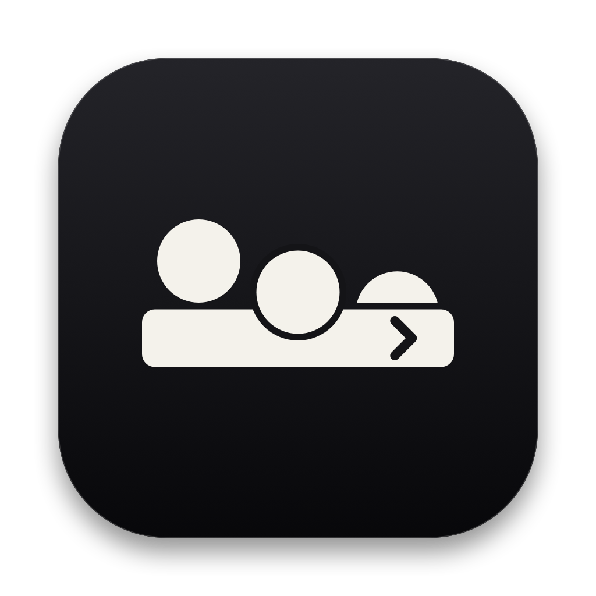

# MenuTuck

<p align="center">
  
</p>

<p align="center">
  <strong>Native macOS Menu Bar Icon Manager</strong><br/>
  Hide, reveal, and organize menu bar icons into <em>Visible</em>, <em>Hidden</em>, and <em>Always Hidden</em> sections. A small Swift app, MIT-licensed, no Screen Recording permission.
</p>

<p align="center">
  <a href="https://github.com/acchuang/MenuTuck/releases/latest/download/MenuTuck.dmg"><strong>⬇ Download MenuTuck.dmg (v0.1.2)</strong></a> ·
  <a href="https://github.com/acchuang/MenuTuck/releases/latest/download/MenuTuck-macOS.zip"><strong>⬇ Download MenuTuck-macOS.zip</strong></a> ·
  <a href="https://github.com/acchuang/MenuTuck/releases"><strong>All Releases</strong></a>
</p>

---

## Download & Install

1. Download [**`MenuTuck.dmg`**](https://github.com/acchuang/MenuTuck/releases/latest/download/MenuTuck.dmg) (or [**`MenuTuck-macOS.zip`**](https://github.com/acchuang/MenuTuck/releases/latest/download/MenuTuck-macOS.zip)) from the [latest GitHub Release](https://github.com/acchuang/MenuTuck/releases/latest).
2. Drag **`MenuTuck.app`** into **`/Applications`**.
3. Clear the macOS quarantine attribute (since the binary uses ad-hoc code signing) and launch:
   ```bash
   xattr -cr /Applications/MenuTuck.app
   open /Applications/MenuTuck.app
   ```
4. Grant **Accessibility** access when prompted (**System Settings → Privacy & Security → Accessibility**) so MenuTuck can detect live `⌘`-drags across dividers and trigger menu bar items.

**After updating:** the build is ad-hoc signed, so every new version looks like a different app to macOS and the Accessibility grant silently stops working. Remove **MenuTuck** from **System Settings → Privacy & Security → Accessibility** with **–**, then add it again (or run `tccutil reset Accessibility com.acchuang.MenuTuck` and relaunch).

**Verified on macOS 27.0.1 and 27.2 only.** On macOS 14–26, MenuTuck uses native hiding if the private API is present and the `10,000 pt` spacer fallback if not. Neither path has been run on those versions. See [Known limitations](#known-limitations).

---

## Features

- **Three Menu Bar Sections (`Visible`, `Hidden`, `Always Hidden`)**:
  - **`|‹` / `|›` (Hidden Divider & Toggle)**: Sits between the **Hidden** section (to its left) and the **Visible** section (to its right).
  - **`‖` (Always-Hidden Divider)**: Sits between the **Always Hidden** section (to its left) and the **Hidden** section (to its right).
- **Native In-Place Hiding (`MenuBarAgent`, tested on macOS 27)**:
  - Uses `MenuBarClientCore` (`MBAssessmentModeAssertion`) to hide and restore third-party menu bar icons in place, with no Screen Recording permission.
  - Falls back to expandable `NSStatusItem` spacers (`10,000 pt`) when that API is unavailable (untested, see below).
- **Two Ways to Organize Icons**:
  - **In the Menu Bar**: Hold `⌘` and drag any icon to the left of `|‹` / `|›` to hide it, or to the left of `‖` to always hide it.
  - **In Settings (`Menu Bar Items` tab)**: Assign any running menu bar app to **Visible**, **Hidden**, or **Always Hidden** with the section picker, or click **Click** to trigger its menu bar item remotely.
- **Quick Controls**:
  - **Left-click `|‹` / `|›`**: Toggle Hidden icons.
  - **Option-click (`⌥`-click) `|‹` / `|›` or click `‖`**: Show All icons (including Always Hidden).
  - **Right-click `|‹` / `|›`**: Open the quick menu (*Show/Hide Icons*, *Show All Icons*, *Settings…*, *Quit*).
  - **Global Shortcut (`⌃⌥M`)**: Toggle Hidden icons from anywhere.
- **Auto-Rehide & Launch at Login**:
  - Automatically collapses hidden icons after a configurable delay (`3–60 s`) or when clicking outside the menu bar.
  - Native `SMAppService` Launch at Login support.

---

## What's new in v0.1.2

- **No more repeated Accessibility windows.** Without the permission, MenuTuck used to open Settings and the system prompt on every menu bar layout change. It now does so once per launch.
- **Failed hiding retries.** If activating in-place hiding fails, MenuTuck clears its state so the next apply tries again instead of staying stuck.
- **`scripts/package.sh`** no longer overwrites the installed app.

## What's new in v0.1.1

- **Safer private-API use.** MenuTuck now checks that every private `MenuBarClientCore` selector it calls exists before enabling in-place hiding, and uses the spacer fallback if any is missing.
- **Activation errors are logged.** A failed `activate` call now shows up in the unified log (subsystem `com.acchuang.MenuTuck`, category `MenuBarHider`) instead of being dropped.
- **MIT `LICENSE`** added.
- **`scripts/package.sh`** builds the `.dmg` and `.zip` and prints their SHA-256.
- **README claims trimmed** to what was measured or checked: the unverified competitor numbers are gone.

## MenuTuck at a glance

Measured on macOS 27.0.1 (running instance, idle):

| Metric | MenuTuck |
| --- | --- |
| App bundle / binary size | `1.8 MB` / `600 KB` |
| Memory (`phys_footprint`) | `~82 MB` |
| Idle CPU (`top`) | `~0.4%` |
| Third-party dependencies | None (Apple frameworks only) |
| Screen Recording permission | Not requested |
| License / cost | MIT, free |

## Alternatives

Other menu bar managers worth a look. Licenses as listed by each project; compare features yourself.

| App | License / cost |
| --- | --- |
| [Bartender](https://www.macbartender.com) | Proprietary, paid |
| [Ice](https://github.com/jordanbaird/Ice) | GPL-3.0, free |
| [Hidden Bar](https://github.com/dwarvesf/hidden) | MIT, free |

## Known limitations

- **Private API.** In-place hiding uses Apple's private `MenuBarClientCore` framework. A macOS update can change or remove it. MenuTuck checks that the expected selectors exist and falls back to the spacer path if not, but that check can't catch every change.
- **Older macOS untested.** Only macOS 27.0.1 and 27.2 have been tried. I don't know which of macOS 14–26 ship `MenuBarClientCore`, or whether the `10,000 pt` spacer fallback works on them.
- **Hardcoded system items.** The hide list allows system menu bar items `0...15` and assumes `4` is the keyboard item. If a future macOS adds an item with a higher ID, MenuTuck may hide it.
- **Multiple displays.** "Re-hide on outside click" measures the menu bar against the main screen only, so it can misfire when you click on a second display. Only a single display has been tried.
- **Crash loop.** If MenuTuck crashes at login after a macOS update, remove it from **System Settings → General → Login Items** and open an issue.
- **Not notarized.** Ad-hoc signed, hence the `xattr -cr` step and the Accessibility re-grant after each update.

## Bugs & feedback

Open an issue: [github.com/acchuang/MenuTuck/issues](https://github.com/acchuang/MenuTuck/issues). Include your macOS version.

---

## Architecture

| File | Responsibility |
| --- | --- |
| [`Sources/MenuTuck/main.swift`](Sources/MenuTuck/main.swift) | App entry point (`NSApplication.ActivationPolicy.accessory`). |
| [`Sources/MenuTuck/AppDelegate.swift`](Sources/MenuTuck/AppDelegate.swift) | App lifecycle, startup scan, and Settings window routing. |
| [`Sources/MenuTuck/SectionController.swift`](Sources/MenuTuck/SectionController.swift) | Manages the `|‹`/`|›` and `‖` status items, self-targeted `AXUIElement` frame tracking, hotkeys, and auto-rehide timers. |
| [`Sources/MenuTuck/MenuBarHider.swift`](Sources/MenuTuck/MenuBarHider.swift) | Bridges `MenuBarClientCore` (`MBAssessmentModeAssertion` & `MBAssessmentModeConfiguration`) for native in-place icon hiding. |
| [`Sources/MenuTuck/MenuBarScanner.swift`](Sources/MenuTuck/MenuBarScanner.swift) | Parallel `AXUIElement` (`kAXExtrasMenuBarAttribute`) scanner and action dispatcher. |
| [`Sources/MenuTuck/ItemsModel.swift`](Sources/MenuTuck/ItemsModel.swift) | Classifies items relative to `|›` and `‖` and reconciles live `⌘`-drags with Settings overrides. |
| [`Sources/MenuTuck/Preferences.swift`](Sources/MenuTuck/Preferences.swift) | `UserDefaults`-backed observable settings and per-app section overrides. |
| [`Sources/MenuTuck/SettingsView.swift`](Sources/MenuTuck/SettingsView.swift) | SwiftUI Settings interface (*Menu Bar Items* and *General* tabs). |

---

## Build from Source

Requirements: macOS 14.0+ and Xcode / Swift 5.10+.

```bash
git clone https://github.com/acchuang/MenuTuck.git
cd MenuTuck

# Build release app bundle and install to /Applications/MenuTuck.app
./scripts/build-app.sh release

# Build MenuTuck.dmg and MenuTuck-macOS.zip into build/ (prints SHA-256)
./scripts/package.sh

# Optional: regenerate Resources/AppIcon.icns from CoreGraphics script
swift scripts/generate-icon.swift
```

## License

MIT © acchuang
