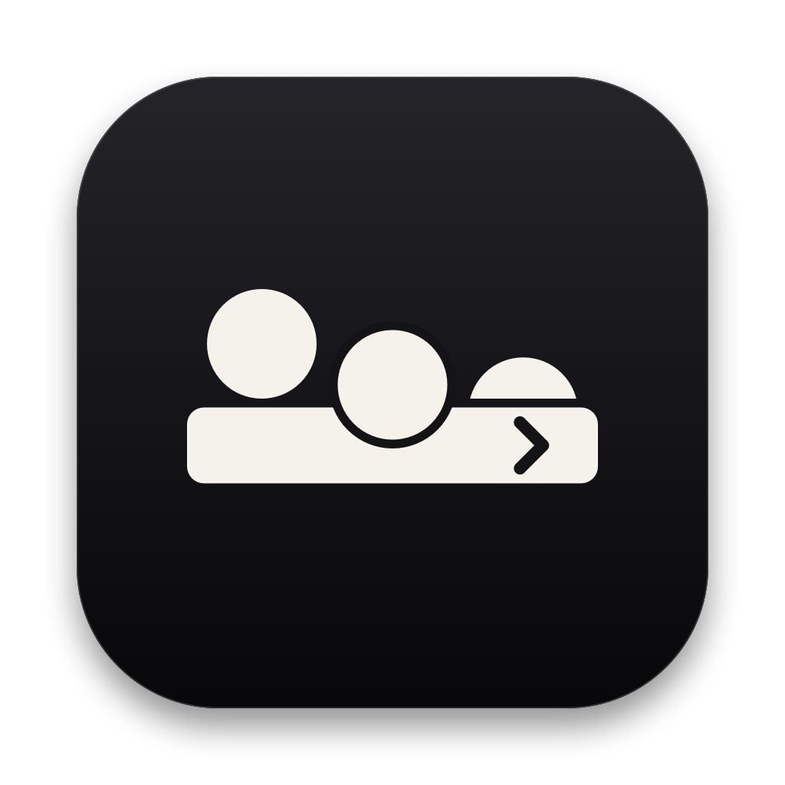

# MenuTuck

<p align="center">
  
</p>

<p align="center">
  <strong>Native macOS Menu Bar Icon Manager</strong><br/>
  Hide, reveal, and organize menu bar icons into <em>Visible</em>, <em>Hidden</em>, and <em>Always Hidden</em> sections. A small Swift app for macOS 27+, MIT-licensed, no Screen Recording permission.
</p>

<p align="center">
  <a href="https://github.com/acchuang/MenuTuck/releases/latest/download/MenuTuck.dmg"><strong>⬇ Download MenuTuck.dmg (v0.1.6)</strong></a> ·
  <a href="https://github.com/acchuang/MenuTuck/releases/latest/download/MenuTuck-macOS.zip"><strong>⬇ Download MenuTuck-macOS.zip</strong></a> ·
  <a href="https://github.com/acchuang/MenuTuck/releases"><strong>All Releases</strong></a>
</p>

---

## Download & Install

1. Download [**`MenuTuck.dmg`**](https://github.com/acchuang/MenuTuck/releases/latest/download/MenuTuck.dmg) (or [**`MenuTuck-macOS.zip`**](https://github.com/acchuang/MenuTuck/releases/latest/download/MenuTuck-macOS.zip)) from the [latest GitHub Release](https://github.com/acchuang/MenuTuck/releases/latest).
2. Drag **`MenuTuck.app`** into **`/Applications`**.
3. Clear the macOS quarantine attribute (the app is signed with a self-signed certificate and is not notarized) and launch:
   ```bash
   xattr -cr /Applications/MenuTuck.app
   open /Applications/MenuTuck.app
   ```
4. Grant **Accessibility** access when prompted (**System Settings → Privacy & Security → Accessibility**) so MenuTuck can detect live `⌘`-drags across dividers and trigger menu bar items.

**Updating from v0.1.5 or earlier:** those builds were ad-hoc signed, so macOS sees v0.1.6 as a different app and the Accessibility grant silently stops working. One last time, remove **MenuTuck** from **System Settings → Privacy & Security → Accessibility** with **–**, then add it again (or run `tccutil reset Accessibility com.acchuang.MenuTuck` and relaunch). From v0.1.6 on, releases share one signing certificate and the grant survives updates. Right-click `|‹` / `|›` → **Check for Updates…** tells you when a newer release exists.

**Requires macOS 27.0 or later.** Verified on macOS 27.0.1 and 27.2. If a macOS update removes the private API MenuTuck relies on, it shows an alert at launch and leaves your menu bar untouched. See [Known limitations](#known-limitations).

---

## Features

- **Three Menu Bar Sections (`Visible`, `Hidden`, `Always Hidden`)**:
  - **`|‹` / `|›` (Hidden Divider & Toggle)**: Sits between the **Hidden** section (to its left) and the **Visible** section (to its right).
  - **`‖` (Always-Hidden Divider)**: Sits between the **Always Hidden** section (to its left) and the **Hidden** section (to its right).
- **Native In-Place Hiding (`MenuBarAgent`, tested on macOS 27.0.1 and 27.2)**:
  - Uses `MenuBarClientCore` (`MBAssessmentModeAssertion`) to hide and restore third-party menu bar icons in place, with no Screen Recording permission.
- **Two Ways to Organize Icons**:
  - **In the Menu Bar**: Hold `⌘` and drag any icon to the left of `|‹` / `|›` to hide it, or to the left of `‖` to always hide it.
  - **In Settings (`Menu Bar Items` tab)**: Assign any running menu bar app to **Visible**, **Hidden**, or **Always Hidden** with the section picker (accompanied by a live `[Always Hidden] ‖ [Hidden] |› [Visible]` layout bar), or click **Open Menu** to trigger its menu bar item remotely.
- **Quick Controls**:
  - **Left-click `|‹` / `|›`**: Toggle Hidden icons.
  - **Option-click (`⌥`-click) `|‹` / `|›` or click `‖`**: Show All icons (including Always Hidden).
  - **Right-click `|‹` / `|›`**: Open the quick menu (*Show/Hide Icons*, *Show All Icons*, *Settings…*, *Check for Updates…*, *Quit*).
  - **Global Shortcuts**: Toggle Hidden icons from anywhere (`⌃⌥M` by default), plus an optional Show All shortcut. Both are recordable in Settings.
- **Auto-Rehide & Launch at Login**:
  - Automatically collapses hidden icons after a configurable delay (`3–60 s`) or when clicking outside the menu bar.
  - Native `SMAppService` Launch at Login support.

---

## What's new in v0.1.6

- **Accessibility grant survives updates.** Releases are now signed with one self-signed certificate instead of ad-hoc, so macOS keeps recognizing the app. **Upgrading from v0.1.5 needs one last remove-and-re-add of MenuTuck under Accessibility.** Still not notarized, so the `xattr -cr` step stays.
- **Check for Updates….** New item in the right-click menu. It makes one request to the GitHub Releases API when you click it, and offers to open the release page. Nothing is checked in the background.
- **macOS 27 only.** The minimum is now 27.0. The `10,000 pt` spacer fallback is deleted: it hid nothing on 27.2 and was never run elsewhere. If the private API is missing, MenuTuck shows an alert at launch and leaves your menu bar alone.

## What's new in v0.1.5

- **Optional hover-to-reveal.** *General → Auto-Hide → Reveal hidden icons when hovering over `|›`* (off by default) expands the Hidden section after a 300 ms dwell on the toggle. Collapse still uses auto-hide or an outside click. The mouse monitor is only installed while the setting is on.
- **Lower idle cost.** Divider positions are polled every `0.35 s` only while `⌘` is held (plus a 1 s tail), and every `5 s` otherwise; they used to be polled at `0.35 s` around the clock. The pre-collapse scan now rechecks only apps already known to own menu bar items, the full scan skips background-only apps, and the Settings window is released when closed.
- **Internal.** `SectionController` and `SettingsView` split into `MenuSection.swift`, `StatusImages.swift` and `OnboardingView.swift`. No behavior change.

## What's new in v0.1.4

- **Live menu bar layout & posture bar.** The *Menu Bar Items* tab now features a dedicated top posture bar showing a live left-to-right spatial diagram (`Always Hidden ‖ Hidden |› Visible`) that highlights active sections alongside an unambiguous `Collapsed` / `Expanded` / `Show All` state switcher.
- **Keep the menu bar expanded while organizing in Settings.** Moving an icon to *Hidden* or *Always Hidden* via the Settings picker now updates in place instead of forcibly collapsing the menu bar after each change, and preserves Settings picker overrides across scans unless an icon physically crosses a divider.
- **First-run & post-update Accessibility onboarding.** Before Accessibility is granted, *Menu Bar Items* displays a focused onboarding and permission view with a 3-step visual guide, live permission polling, and instructions for the `–` / `+` System Settings re-grant step after ad-hoc updates.
- **Refined controls, grouped General settings, and icon caching.** Renamed row and footer actions (*Open Menu*, *Rescan Menu Bar* with *"Synced"* confirmation), added spatial section badges (`Right of |›`, `Left of |›`, `Left of ‖`), split *General* into *Auto-Hide*, *Sections & Dividers*, and *Shortcuts & Startup*, made error banners dismissible, added an empty-search recovery state, and cached app icons by PID.

## What's new in v0.1.3

- **Refreshed app icon.** High-contrast tactile graphite and warm cream icon (`16×16` through `1024×1024`).
- **Outside-click re-hide uses the right screen.** It measures the menu bar on the screen you clicked, not the key-window screen, and sizes the bar from that screen's real height (30 pt external, 38 pt notched). Previously a fixed 36 pt band treated clicks on a notched bar as outside it.
- **Menu bar items on a display left of the primary are detected.** The on-menu-bar filter used to drop their negative x positions.
- **Settings warns when the private API is missing**, since the spacer fallback hides nothing on 27.2.
- **Scanner fix and cleanup.** A malformed bundle ID in the scanner's exclusion list is fixed, and the unused `ItemMover` is deleted.
- **Unit tests.** `swift test` covers the on-menu-bar filter.

## What's new in v0.1.2

- **No more repeated Accessibility windows.** Without the permission, MenuTuck used to open Settings and the system prompt on every menu bar layout change. It now does so once per launch.
- **Failed hiding retries.** If activating in-place hiding fails, MenuTuck clears its state so the next apply tries again instead of staying stuck.
- **`scripts/package.sh`** no longer overwrites the installed app.

## What's new in v0.1.1

- **Safer private-API use.** MenuTuck now checks that every private `MenuBarClientCore` selector it calls exists before enabling in-place hiding, and uses the spacer fallback if any is missing.
- **Activation errors are logged.** A failed `activate` call now shows up in the unified log (subsystem `com.acchuang.MenuTuck`, category `MenuBarHider`) instead of being dropped.
- **MIT `LICENSE`** added.
- **`scripts/package.sh`** builds the `.dmg` and `.zip` and prints their SHA-256.
- **README claims trimmed** to what was measured or checked: the unverified competitor numbers are gone.

## MenuTuck at a glance

Measured on macOS 27.2 (release build from before v0.1.6, fresh launch, idle, 60 s sample; v0.1.6 not re-measured):

| Metric | MenuTuck |
| --- | --- |
| App bundle / binary size | `~910 KB` / `630 KB` (not re-measured) |
| Memory (`phys_footprint`) | `~15 MB` fresh; the v0.1.4 build grew to `~84 MB` over ~5 days of uptime (growth not re-checked on this build) |
| Idle CPU (`top`) | `~0.05%` (v0.1.4 measured `~1.3%`) |
| Third-party dependencies | None (Apple frameworks only) |
| Screen Recording permission | Not requested |
| Network | None, except one GitHub request when you click *Check for Updates…* |
| License / cost | MIT, free |

## Alternatives

Other menu bar managers worth a look. Licenses as listed by each project; compare features yourself.

| App | License / cost |
| --- | --- |
| [Bartender](https://www.macbartender.com) | Proprietary, paid |
| [Ice](https://github.com/jordanbaird/Ice) | GPL-3.0, free |
| [Hidden Bar](https://github.com/dwarvesf/hidden) | MIT, free |

## Known limitations

- **Private API.** In-place hiding uses Apple's private `MenuBarClientCore` framework. A macOS update can change or remove it. MenuTuck checks that the expected selectors exist and, if not, shows an alert at launch and hides nothing, but that check can't catch every change.
- **macOS 27 only.** Only macOS 27.0.1 and 27.2 have been tried, and older versions won't launch the app. There is no fallback: a spacer-based one hid nothing on 27.2, so it was removed.
- **Hardcoded system items.** The hide list allows system menu bar items `0...15` and assumes `4` is the keyboard item. If a future macOS adds an item with a higher ID, MenuTuck may hide it.
- **Multiple displays.** "Re-hide on outside click" measures the menu bar against the screen you clicked on. The bar height comes from the screen itself (30 pt external, 38 pt notched), with a 36 pt floor for auto-hide. Items on a display left of the primary (negative x) are accepted by the scanner, but I haven't run that layout either. Verified on a 30 pt external plus a 38 pt notched display with aligned top edges; staggered arrangements are untested.
- **Crash loop.** If MenuTuck crashes at login after a macOS update, remove it from **System Settings → General → Login Items** and open an issue.
- **Not notarized.** Signed with a self-signed certificate (no paid Apple Developer ID), hence the `xattr -cr` step. Updates keep your Accessibility grant only while releases are signed with that same certificate; if its key is ever lost, everyone re-grants once.

## Bugs & feedback

Open an issue: [github.com/acchuang/MenuTuck/issues](https://github.com/acchuang/MenuTuck/issues). Include your macOS version.

---

## Architecture

| File | Responsibility |
| --- | --- |
| [`Sources/MenuTuck/main.swift`](Sources/MenuTuck/main.swift) | App entry point (`NSApplication.ActivationPolicy.accessory`). |
| [`Sources/MenuTuck/AppDelegate.swift`](Sources/MenuTuck/AppDelegate.swift) | App lifecycle, startup scan, and Settings window routing. |
| [`Sources/MenuTuck/SectionController.swift`](Sources/MenuTuck/SectionController.swift) | Manages the `|‹`/`|›` and `‖` status items, self-targeted `AXUIElement` frame tracking, hotkeys, and auto-rehide timers. |
| [`Sources/MenuTuck/MenuBarHider.swift`](Sources/MenuTuck/MenuBarHider.swift) | Bridges `MenuBarClientCore` (`MBAssessmentModeAssertion` & `MBAssessmentModeConfiguration`) for native in-place icon hiding. |
| [`Sources/MenuTuck/MenuBarScanner.swift`](Sources/MenuTuck/MenuBarScanner.swift) | Parallel `AXUIElement` (`kAXExtrasMenuBarAttribute`) scanner and action dispatcher. |
| [`Sources/MenuTuck/UpdateChecker.swift`](Sources/MenuTuck/UpdateChecker.swift) | Manual *Check for Updates…*: one GitHub `releases/latest` request, numeric tag compare. |
| [`Sources/MenuTuck/ItemsModel.swift`](Sources/MenuTuck/ItemsModel.swift) | Classifies items relative to `|›` and `‖` and reconciles live `⌘`-drags with Settings overrides. |
| [`Sources/MenuTuck/Preferences.swift`](Sources/MenuTuck/Preferences.swift) | `UserDefaults`-backed observable settings and per-app section overrides. |
| [`Sources/MenuTuck/SettingsWindowController.swift`](Sources/MenuTuck/SettingsWindowController.swift) & [`Sources/MenuTuck/SettingsView.swift`](Sources/MenuTuck/SettingsView.swift) | Settings window and its SwiftUI interface (*Menu Bar Items* and *General* tabs). |
| [`scripts/generate-icon.swift`](scripts/generate-icon.swift) | CoreGraphics generator for [`Resources/AppIcon.icns`](Resources/AppIcon.icns) and [`Resources/AppIcon-1024.png`](Resources/AppIcon-1024.png) (`16×16`–`1024×1024`). |
| [`Tests/MenuTuckTests`](Tests/MenuTuckTests) | Unit tests (on-menu-bar frame filtering, state/section label checks, update-tag compare). |

---

## Build from Source

Requirements: macOS 27.0+ and Xcode / Swift 5.10+.

```bash
git clone https://github.com/acchuang/MenuTuck.git
cd MenuTuck

# Build release app bundle and install to /Applications/MenuTuck.app
./scripts/build-app.sh release

# Build MenuTuck.dmg and MenuTuck-macOS.zip into build/ (prints SHA-256)
./scripts/package.sh

# Run the unit tests
swift test

# Optional: regenerate Resources/AppIcon.icns from CoreGraphics script
swift scripts/generate-icon.swift
```

## License

MIT © acchuang
